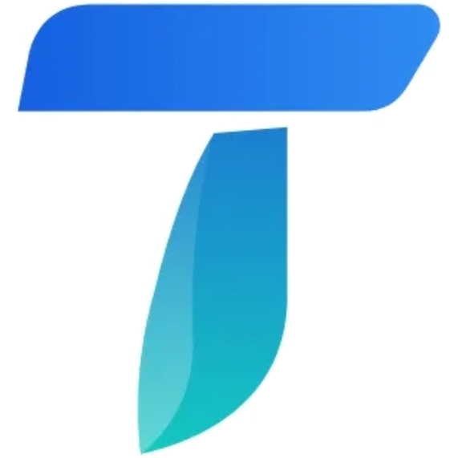
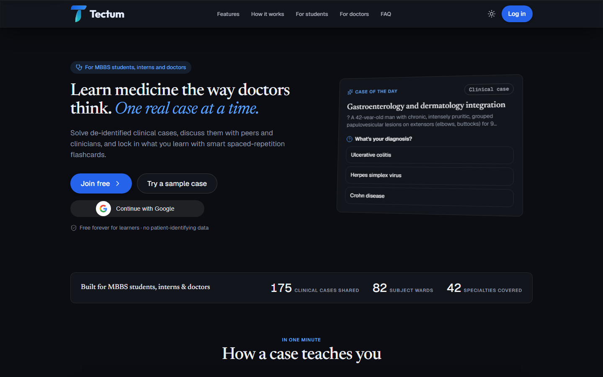
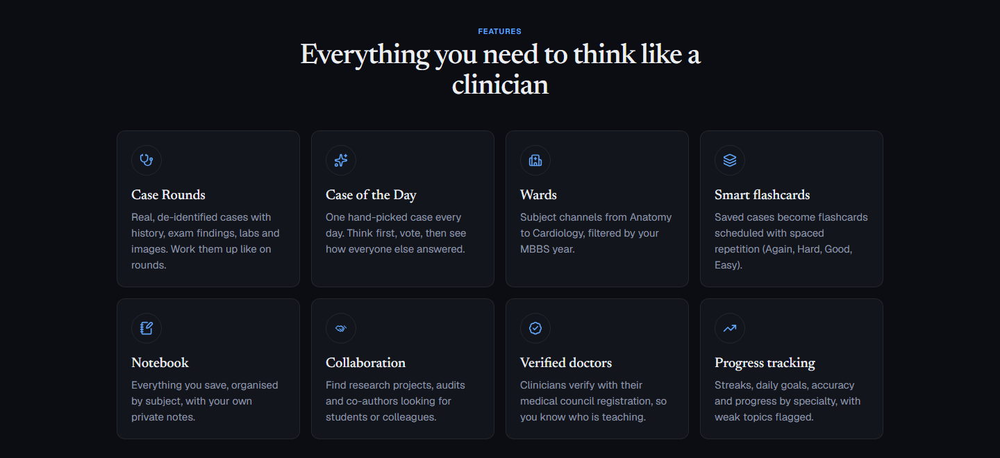
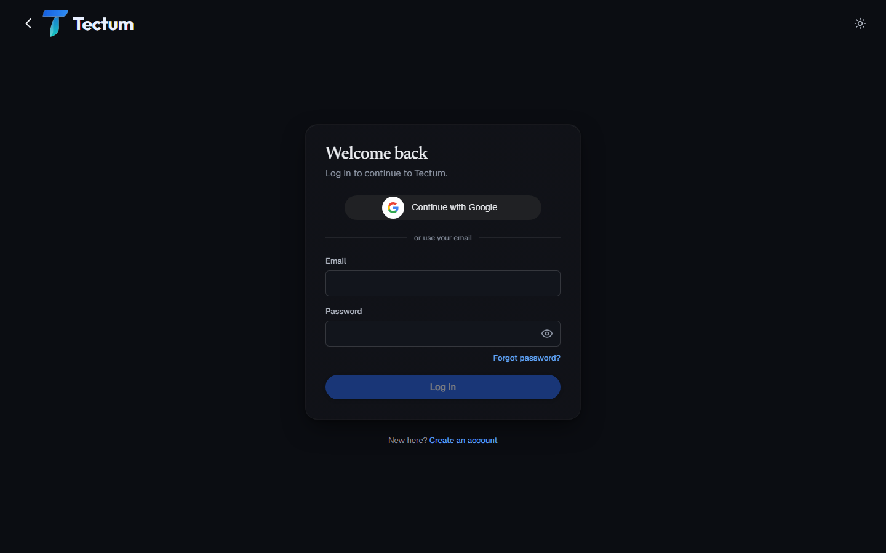

  

<h1 align="center">Tectum</h1>

<b>Learn medicine the way doctors think. One real case at a time.</b>

  Case based learning for MBBS students, interns and doctors: solve de-identified clinical cases,
  discuss them with peers and clinicians, and lock in what you learn with spaced repetition flashcards.

---

## The problem

Medicine isn't learned from answers alone. Most medical students prepare from textbooks and MCQ banks
that test recall, but clinical practice is about **reasoning**: reading a history, spotting the
findings that matter, committing to a diagnosis and knowing why.

- Real clinical cases are scattered across WhatsApp groups and hospital corridors, with no structure and
  often with patient details exposed.
- Students rarely get to discuss a case with a practising doctor, or know whether the person teaching
  them is actually qualified.
- What is learned on rounds is quickly forgotten because there is no system to revise it.

## What Tectum solves

Tectum turns real, de-identified cases into a structured learning loop:

1. **Think first.** Read the case as you would on rounds and commit to a diagnosis before anything is revealed.
2. **Discuss.** See how others answered and learn from the reasoning of peers and verified clinicians.
3. **Remember.** Saved cases come back as flashcards right before you'd forget them.

All of it in one place, free for learners, with patient privacy built in.

## Features

| | |
|---|---|
| **Case Rounds** | Real, de-identified cases with history, exam findings, labs and images. Work them up like on rounds. |
| **Case of the Day** | One hand-picked case every day. Think first, vote, then see how everyone else answered. |
| **Wards** | Subject channels from Anatomy to Cardiology, filtered by your MBBS year. |
| **Smart flashcards** | Saved cases become flashcards scheduled with spaced repetition (Again, Hard, Good, Easy). |
| **Notebook** | Everything you save, organised by subject, with your own private notes. |
| **Collaboration** | Find research projects, audits and co-authors looking for students or colleagues. |
| **Verified doctors** | Clinicians verify with their medical council registration, so you know who is teaching. |
| **Progress tracking** | Streaks, daily goals, accuracy and progress by specialty, with weak topics flagged. |
| **Quizzes** | Create and host quizzes, with results that can be exported. |

## Who it's for

**Students**
- Cases matched to your MBBS year
- Daily goals and streaks that build a habit
- Flashcards that schedule your revision
- Exam-style MCQ tips on every case

**Doctors**
- Share interesting cases with the next generation
- Get verified with your council registration
- Discuss differentials with peers
- Find students for research and audits

## Privacy and safety

- Cases must be de-identified: no names, dates, hospital numbers or faces. Authors confirm this and
  patient consent before posting.
- Photo location data is removed automatically, and members can report anything that slips through.
- Verification documents are checked by hand and are never shown publicly.
- Personal data is processed in line with India's Digital Personal Data Protection Act, 2023.

> Tectum is for education and peer discussion between healthcare learners and professionals.
> It is not medical advice and not a substitute for clinical judgement.

## Built with

**MongoDB · Express · React · Node.js** (MERN), with Vite, Tailwind CSS, TanStack Query, Zustand,
Socket.IO and Cloudinary.

---

© 2026 Tectum. All rights reserved.

